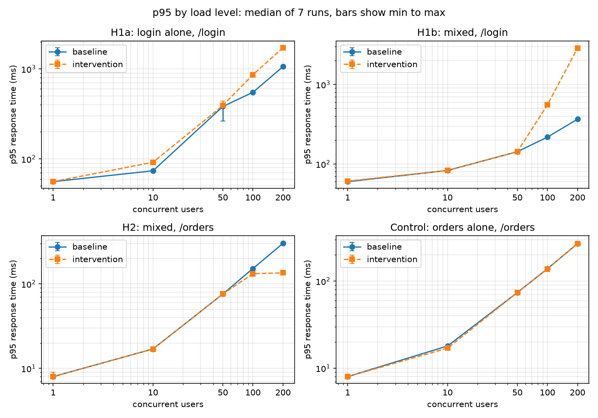

# Results

## 1. Summary

This study asked whether moving CPU-bound work (BCrypt password verification in `POST /login`) onto a dedicated 8-thread executor reduces CPU-bound degradation in a Spring Boot REST API under concurrent load, without harming an I/O-oriented endpoint (`GET /users/{userId}/orders`). Two builds were compared over 210 counted runs: a synchronous baseline and the intervention.

| Hypothesis | Verdict |
|---|---|
| H1a: login p95 improves by at least 10% (login alone) | Not supported. The intervention was slower at 100 and 200 users (+56.8% and +62.4%). |
| H1b: login p95 improves by at least 10% (mixed load) | Not supported. The intervention was slower at 100 and 200 users (+155.0% and +683.9%). |
| H2: no substantial negative effect on `/orders` p95 (mixed load) | Holds. `/orders` p95 was lower at 100 and 200 users (-13.2% and -55.3%), unchanged at 50 users and below. |

Once the CPU saturated, separation traded `/login` latency for `/orders` latency. No effect was observed at 50 users or below.

## 2. What was tested

* **Builds.** Baseline (tag `baseline-v2`): both endpoints synchronous on Tomcat's 200-thread request pool. Intervention (tag `intervention-v1`): `AuthService.login`, including the user lookup and BCrypt verification, runs on `cpuBoundExecutor` (8 core and 8 maximum threads, queue capacity 1000). The Tomcat pool is unchanged at 200.
* **Scenarios.** `login` (only `POST /login`), `orders` (only `GET /users/{userId}/orders`, a control, since this code is identical in both builds) and `mixed` (1 login request per 15 orders requests, enforced by request share).
* **Load.** 1, 10, 50, 100 and 200 concurrent users, with no think time. Each run lasts 120 s with a 10 s ramp-up. The first 30 s are discarded and the remaining 90 s analysed. The API is restarted before every run, with a 60 s cooldown between runs. Build order alternates in pairs (AB, BA).
* **Repetitions.** 7 runs per build, scenario and level (210 runs in 3 batches). No run failed or was repeated, and no request failed an assertion in the analysis windows.
* **System under test.** Single Windows 11 machine, AMD Ryzen 5700X (8 cores, 16 logical processors), 16 GB RAM, running the API, MySQL 8.0.46 and JMeter 5.6.3 together. Temurin 25.0.4.1, Spring Boot 4.1.1, Tomcat 11.0.26, Hikari pool of 10 connections.
* **Data.** 1,000 users, 150 products and 40,000 orders (40 per user), generated once with a fixed seed. The MySQL table checksums were identical before and after every batch. BCrypt strength is 10.

## 3. How results were judged

The analysis plan was written and tagged (`plan-v1`) before any counted run. Its rules were not changed afterwards.

* **Metric.** One p95 response time per run, computed from the raw JMeter samples of the 90 s analysis window. p95 is the value below which 95% of requests fall.
* **Test.** Two-sided Mann-Whitney U test per level on the 7 baseline and 7 intervention p95 values, at p < 0.05.
* **H1** holds at a level if the intervention's p95 is at least 10% lower and p < 0.05. The verdict requires 50, 100 and 200 users all to pass.
* **H2** (`/orders` p95, mixed scenario) is negative at a level if p95 rises by more than 10% with p < 0.05. H2 holds if no level among 50, 100 and 200 users is negative.
* Reported changes compare the median p95 of the 7 baseline runs with the median of the 7 intervention runs.

## 4. Results

Values are median p95 in milliseconds. Changes are relative to the baseline. "n/a" means all runs were identical, so the test has nothing to rank.

### H1a: `/login`, login alone

| Users | Baseline | Intervention | Change | p |
|---|---|---|---|---|
| 1 | 56 | 56 | 0.0% | n/a |
| 10 | 74 | 92 | +24.3% | 0.0013 |
| 50 | 383 | 393 | +2.6% | 0.0405 |
| 100 | 551 | 864 | +56.8% | 0.0021 |
| 200 | 1,062 | 1,725 | +62.4% | 0.0021 |

### H1b: `/login`, mixed scenario

| Users | Baseline | Intervention | Change | p |
|---|---|---|---|---|
| 1 | 60 | 61 | +1.7% | 0.0447 |
| 10 | 83 | 83 | 0.0% | 0.2084 |
| 50 | 143 | 143 | 0.0% | 0.7377 |
| 100 | 218 | 556 | +155.0% | 0.0021 |
| 200 | 366 | 2,869 | +683.9% | 0.0021 |

### H2: `/orders`, mixed scenario

| Users | Baseline | Intervention | Change | p |
|---|---|---|---|---|
| 1 | 8 | 8 | 0.0% | 0.3914 |
| 10 | 17 | 17 | 0.0% | n/a |
| 50 | 76 | 76 | 0.0% | 0.4781 |
| 100 | 152 | 132 | -13.2% | 0.0020 |
| 200 | 302 | 135 | -55.3% | 0.0020 |

### Control: `/orders`, orders alone

| Users | Baseline | Intervention | Change | p |
|---|---|---|---|---|
| 1 | 8 | 8 | 0.0% | n/a |
| 10 | 18 | 17 | -5.6% | 0.1411 |
| 50 | 74 | 74 | 0.0% | 1.0000 |
| 100 | 139 | 138 | -0.7% | 0.9456 |
| 200 | 270 | 270 | 0.0% | 0.6937 |

The control shows no difference between builds at any level, as expected for identical code.

Levels 1 and 10 users are descriptive only, as stated in the plan. The automatic labels the analysis script prints for them are not meaningful.

## 5. Interpretation

**Mechanism.** In the baseline, up to 200 login requests can be inside BCrypt at the same time, sharing the machine's 16 logical processors with MySQL and the other requests. In the intervention, at most 8 logins run BCrypt at once and the remainder wait in the executor's queue. A waiting request uses no CPU, so `/orders` requests and MySQL receive a larger share of it. This is consistent with the observed pattern: no difference at 50 users and below, and a divergence once the CPU saturated (100 and 200 users). The explanation was not tested directly, since executor queue length was not recorded.

**What the data support.** In this configuration, separation did not reduce login degradation. It increased login p95 at saturation in both scenarios, and it reduced `/orders` p95 in the mixed scenario. The orders-only control shows no difference between builds, so the measurement method does not itself produce differences.

**Scope.** The results hold for this machine, a 1:15 request mix, a connection pool of 10 and an executor of 8 threads with a queue of 1000. Other ratios, hardware, pool sizes and executor sizes were not tested. The trade-off observed here would favour separation only where protecting the I/O-oriented endpoint matters more than login latency.

**Pilot comparison.** The pilot (3 intervention runs) showed `/orders` p95 about 28% lower at 200 users in the mixed scenario. The counted result (7 runs) is 55% lower. The counted result is the one reported.

## 6. Limitations

* **Single machine.** The API, MySQL and JMeter share one CPU, so absolute values are specific to this setup. Only the comparison between builds is meaningful.
* **`/orders` is not I/O-bound on this machine.** In the pilot's 200-user mixed runs, `mysqld` used about 970% CPU (percent of one core) against about 370% for the API, because the unindexed query runs on the same CPU. "I/O-oriented" describes the design intent, not a measured property.
* **Connection pool.** Fixed at 10. In the pilot, a pool of 50 gave `/orders` p95 of 831 and 939 ms against 285 ms at 10 (orders alone, 200 users, baseline). Whether the intervention's effect depends on the pool size was not tested.
* **One intervention design.** The whole `login()` method, including the user lookup, runs on the executor, and the executor has one configuration (8 threads, queue 1000).
* **Load model.** No think time, so 200 users means 200 constantly busy clients. One request mix (1:15) was used.
* **Resolution.** Levels between 50 and 100 users were not tested, so the onset of the effect is only bracketed.
* **Secondary metrics.** Throughput and p99 are recorded in `analysis/runs.csv` and are not reported here. p99 is unreliable for login in the mixed scenario, where a run holds about 3,900 login requests.
* **Run-to-run noise.** About one in six pilot runs showed an unexplained slowdown. Counted runs were kept without exclusion, and the median and the rank test limit its influence.
* **Synthetic data.** Users, products and orders were generated. BCrypt strength 10 costs about 54.5 ms per check on this CPU.

## 7. Reproduction

| Item | Identifier |
|---|---|
| Analysis plan | tag `plan-v1`, commit `7230f6a28948da3290249eb3484f2d322ec0de43` |
| Baseline | tag `baseline-v2`, commit `00c19ebcd8486ee81c9a5079680524ccf87c2307`, jar SHA-256 `c875668229e2c9419e607ccccac6edfc3736d506b9e9d4fbfb3d0263c8d26f08` |
| Intervention | tag `intervention-v1`, commit `30a0166b68481b633c64915b0bbce42488872f35`, jar SHA-256 `c411d1a3211b8cb7d3144f667520e63bb392100e056aca073a0f7ece1b88cdff` |
| Database dump | `db/cpu_io_benchmark_db.sql`, SHA-256 `8569431a55f23e7f4880a1e32f242357f051e921929a5252951dd68aba2f6df9` |
| Credentials file | `db/seeded-users.csv`, SHA-256 `552af2311d76d5618fc563000a877ac0d15919a7a4232bef9160f5c5d1034837` |
| Benchmark settings | `config/benchmark.properties`, SHA-256 `a4556f6db23ff6f94e4f48b5b3a311410bbafbbd6e04ccdc4e717833865731cb` |
| Raw results archive | `final_backup.zip`, SHA-256 `173d9e67eb44f38235524326b3d501ab4ccdd2a28db5641cf7e1dd1bcd30d8da` (not in the repository) |

1. Restore the dump and verify the dataset checksums, as described in the README.
2. Build each tag once with Temurin 25.0.4.1, copy the jars to `artifacts/` and record their SHA-256 values in `scripts/driver_config.json`. Rebuilt jars have the same code but different hashes (the build embeds timestamps), and the driver refuses to start if a hash does not match its configuration.
3. Close the JMeter GUI, restart MySQL, and run `CHECKSUM TABLE users, products, orders` before and after each batch.
4. Run each batch from the project root: `python -c "import sys; sys.path.insert(0,'scripts'); import driver; driver.run_batch('<name>', <first>, <last>)"`, using runs 1 to 70, 71 to 140 and 141 to 210 of `scripts/schedule.csv`.
5. Analyse with `python scripts/analyze_runs.py results/final`, then `python scripts/verdicts.py` and `python scripts/make_figures.py`.

Absolute numbers will differ on other hardware. The comparison between builds is what should be reproduced.