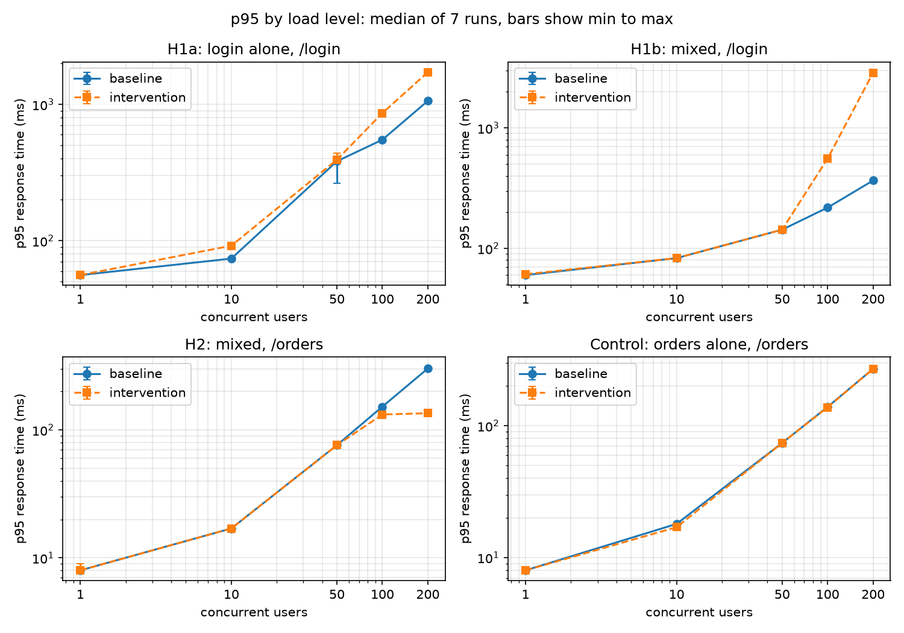
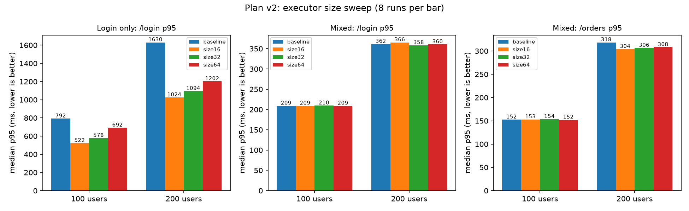
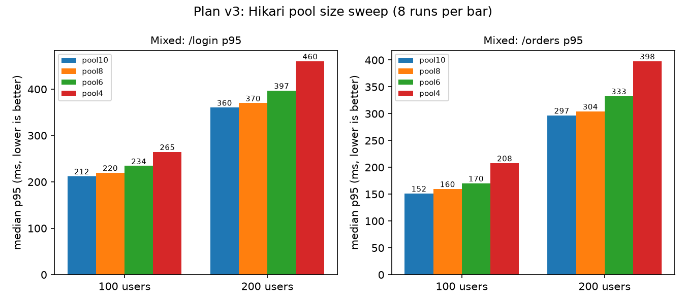

# Results

## 1. Summary

This study asked whether moving CPU-bound work (BCrypt password verification in `POST /login`) onto a dedicated executor reduces CPU-bound degradation in a Spring Boot REST API under concurrent load, without harming an I/O-oriented endpoint (`GET /users/{userId}/orders`). It has three parts. Plan v1 is pre-registered and confirmatory. Plans v2 and v3 are exploratory follow-ups.

### Plan v1 (pre-registered, 210 runs): baseline against an 8-thread executor

| Hypothesis | Verdict |
|---|---|
| H1a: login p95 improves by at least 10% (login alone) | Not supported. The intervention was slower at 100 and 200 users (+56.8% and +62.4%). |
| H1b: login p95 improves by at least 10% (mixed load) | Not supported. The intervention was slower at 100 and 200 users (+155.0% and +683.9%). |
| H2: no substantial negative effect on `/orders` p95 (mixed load) | Holds. `/orders` p95 was lower at 100 and 200 users (-13.2% and -55.3%), unchanged at 50 users and below. |

Once the CPU saturated, separation traded `/login` latency for `/orders` latency. No effect was observed at 50 users or below.

### Plan v2 (exploratory, 128 runs): executor sizes 16, 32 and 64 against the baseline, at 100 and 200 users

| Scenario | Finding |
|---|---|
| Login only | Login p95 was lower than the baseline at every size and level (-12.7% to -37.2%, all Holm-adjusted p of 0.0027 or less). Throughput, CPU use and mean latency did not change. The gain was largest at size 16 and shrank as the executor grew. |
| Mixed (1:15) | Login p95 matched the baseline at every size (within 1.1%). `/orders` p95 at 200 users was 3% to 5% lower, which did not reach the 10% threshold. |

No tested size improved login in the mixed scenario, and none retained the `/orders` benefit seen with 8 threads in plan v1.

### Plan v3 (exploratory, 64 runs): database pool sizes 4, 6 and 8 against 10, mixed scenario, 100 and 200 users

No pool size met the aim. Smaller pools raised login p95 (up to +27.7%) and lowered throughput for both endpoints. Only one cell, pool 8 for `/orders` at 200 users, met its safety limit.

### Overall

Within the tested range, no configuration improved `/login` in the mixed scenario by the pre-set thresholds without a cost to `/orders`. The only improvement in login p95 appeared in the login-only scenario, with executors of 16 to 64 threads.

## 2. What was tested

* **Builds.**
    * Baseline (tag `baseline-v2`): both endpoints synchronous on Tomcat's 200-thread request pool.
    * Intervention (tag `intervention-v1`): `AuthService.login`, including the user lookup and BCrypt verification, runs on `cpuBoundExecutor` (8 core and 8 maximum threads, queue capacity 1000). The Tomcat pool is unchanged at 200.
    * Configurable executor (tag `intervention-v2`): the same design with the size set by `--app.cpu-executor.size=N`. Plan v2 used sizes 16, 32 and 64.
    * Pool builds (plan v3): the baseline jar, launched with `--spring.datasource.hikari.maximum-pool-size=N` and `--spring.datasource.hikari.minimum-idle=N`.
* **Scenarios.** `login` (only `POST /login`), `orders` (only `GET /users/{userId}/orders`, a control in plan v1, since this code is identical in both builds) and `mixed` (1 login request per 15 orders requests, enforced by request share).
* **Load.** Plan v1 used 1, 10, 50, 100 and 200 concurrent users. Plans v2 and v3 used 100 and 200 users only. There is no think time. Each run lasts 120 s with a 10 s ramp-up. The first 30 s are discarded and the remaining 90 s analysed. The API is restarted before every run, with a 60 s cooldown between runs.
* **Repetitions.** Plan v1: 7 runs per build, scenario and level (210 runs in 3 batches), build order alternating in pairs (AB, BA). Plans v2 and v3: 8 runs per condition, build order rotating within blocks of four (not a random shuffle). No run failed or was repeated in any plan, and no request failed in the analysis windows.
* **System under test.** Single Windows 11 machine, AMD Ryzen 5700X (8 cores, 16 logical processors), 16 GB RAM, running the API, MySQL 8.0.46, JMeter 5.6.3 and the monitoring script together. Temurin 25.0.4.1, Spring Boot 4.1.1, Tomcat 11.0.26. The Hikari pool is 10 connections except in plan v3.
* **Data.** 1,000 users, 150 products and 40,000 orders (40 per user), generated once with a fixed seed. The MySQL table checksums were identical before and after every batch of all three plans. BCrypt strength is 10.

## 3. How results were judged

### Plan v1

The analysis plan was written and tagged (`plan-v1`) before any counted run. Its rules were not changed afterwards.

* **Metric.** One p95 response time per run, computed from the raw JMeter samples of the 90 s analysis window. p95 is the value below which 95% of requests fall.
* **Test.** Two-sided Mann-Whitney U test per level on the 7 baseline and 7 intervention p95 values, at p < 0.05.
* **H1** holds at a level if the intervention's p95 is at least 10% lower and p < 0.05. The verdict requires 50, 100 and 200 users all to pass.
* **H2** (`/orders` p95, mixed scenario) is negative at a level if p95 rises by more than 10% with p < 0.05. H2 holds if no level among 50, 100 and 200 users is negative.
* Reported changes compare the median p95 of the 7 baseline runs with the median of the 7 intervention runs.

### Plan v2 (exploratory)

* Same metric and test as plan v1, on 8 runs per condition, with a Holm correction across the 3 sizes for each scenario, level and endpoint (`scripts/analyze_v2.py`).
* Login outcomes: IMPROVEMENT (at least 10% lower with adjusted p < 0.05), RECOVERY (no more than 10% higher), DEGRADED (more than 10% higher). Orders outcomes: HARM (more than 10% higher with adjusted p < 0.05), BENEFIT RETAINED (at least 10% lower with adjusted p < 0.05), BENEFIT LOST (otherwise).
* The headline was defined as the smallest size with login recovery at both levels in the mixed scenario and the `/orders` benefit retained.
* The analysis script was written after the plan was tagged and first run on batch 1 data, not on pilot data as the plan intended. The rules it applies are those written in plan v2.

### Plan v3 (exploratory)

The plan was tagged (`plan-v3`) before the first run. The thresholds below were fixed in advance.

* **Control.** Pool 10, rerun inside the batch. Earlier baselines were not reused.
* **Login.** Mixed `/login` p95 must be at least 10% lower at 100 users and at least 15% lower at 200 users, with a Holm-adjusted p below 0.05 across the 3 pool sizes.
* **Orders (safety).** `/orders` p95 must not be worse by 5% or more at 100 users, or by 10% or more at 200 users. A size passes only if the upper bound of the 95% bootstrap confidence interval for the change in median p95 stays below the limit (10,000 resamples, seed 42).
* **Success.** A size succeeds only if login and orders both pass at both levels (`scripts/analyze_v3.py`, written after the batch data existed and applying only the rules in the plan).

Values are median p95 in milliseconds. Changes are relative to the control of the same plan. "n/a" means all runs were identical, so the test has nothing to rank.

## 4. Results, plan v1

### H1a: `/login`, login alone

| Users | Baseline | Intervention | Change | p |
|---|---|---|---|---|
| 1 | 56 | 56 | 0.0% | n/a |
| 10 | 74 | 92 | +24.3% | 0.0013 |
| 50 | 383 | 393 | +2.6% | 0.0405 |
| 100 | 551 | 864 | +56.8% | 0.0021 |
| 200 | 1,062 | 1,725 | +62.4% | 0.0021 |

### H1b: `/login`, mixed scenario

| Users | Baseline | Intervention | Change | p |
|---|---|---|---|---|
| 1 | 60 | 61 | +1.7% | 0.0447 |
| 10 | 83 | 83 | 0.0% | 0.2084 |
| 50 | 143 | 143 | 0.0% | 0.7377 |
| 100 | 218 | 556 | +155.0% | 0.0021 |
| 200 | 366 | 2,869 | +683.9% | 0.0021 |

### H2: `/orders`, mixed scenario

| Users | Baseline | Intervention | Change | p |
|---|---|---|---|---|
| 1 | 8 | 8 | 0.0% | 0.3914 |
| 10 | 17 | 17 | 0.0% | n/a |
| 50 | 76 | 76 | 0.0% | 0.4781 |
| 100 | 152 | 132 | -13.2% | 0.0020 |
| 200 | 302 | 135 | -55.3% | 0.0020 |

### Control: `/orders`, orders alone

| Users | Baseline | Intervention | Change | p |
|---|---|---|---|---|
| 1 | 8 | 8 | 0.0% | n/a |
| 10 | 18 | 17 | -5.6% | 0.1411 |
| 50 | 74 | 74 | 0.0% | 1.0000 |
| 100 | 139 | 138 | -0.7% | 0.9456 |
| 200 | 270 | 270 | 0.0% | 0.6937 |

The control shows no difference between builds at any level, as expected for identical code.

Levels 1 and 10 users are descriptive only, as stated in the plan. The automatic labels the analysis script prints for them are not meaningful.

## 5. Results, plan v2 (executor size sweep, exploratory)

128 runs, 8 per condition, 100 and 200 users, baseline against sizes 16, 32 and 64 (the same executor design as plan v1, with a different thread count). Adjusted p values are Holm-corrected across the 3 sizes.

### Login alone: `/login` p95

| Users | Baseline | Size 16 | Size 32 | Size 64 |
|---|---|---|---|---|
| 100 | 792 | 522 (-34.0%, p 0.0027) | 578 (-27.1%, p 0.0027) | 692 (-12.7%, p 0.0027) |
| 200 | 1,630 | 1,024 (-37.2%, p 0.0005) | 1,094 (-32.9%, p 0.0005) | 1,202 (-26.3%, p 0.0005) |

Throughput was about 200 requests per second in every build. Mean latency was about 498 ms at 100 users and 985 to 1,007 ms at 200 users, for all builds. The ratio of p95 to mean latency at 200 users was 1.65 for the baseline and 1.03, 1.09 and 1.19 for sizes 16, 32 and 64. The improvement is therefore in the spread of the latencies, not in their mean.

### Mixed: `/login` p95

| Users | Baseline | Size 16 | Size 32 | Size 64 |
|---|---|---|---|---|
| 100 | 209 | 209 | 210 | 209 |
| 200 | 362 | 366 | 358 | 360 |

Changes are within 1.1% and adjusted p is at least 0.81. Outcome: RECOVERY (no difference from the baseline) at every size.

### Mixed: `/orders` p95

| Users | Baseline | Size 16 | Size 32 | Size 64 |
|---|---|---|---|---|
| 100 | 152 | 153 (+0.7%) | 154 (+0.3%) | 152 (-0.3%) |
| 200 | 318 | 304 (-4.6%, p 0.0534) | 306 (-3.8%, p 0.102) | 308 (-3.3%, p 0.102) |

The 100-user changes have an adjusted p of 1.0. Outcome: BENEFIT LOST at every size, since no change reaches 10%.

### CPU (mean over runs after the 30 s trim)

`sys` is the machine's CPU use in percent. API and MySQL are in percent of one logical processor, so 1,600 would be all 16 busy.

| Scenario | Build | Users | sys % | API | MySQL |
|---|---|---|---|---|---|
| Login only | baseline | 100 / 200 | 98.5 / 97.8 | 1,549 / 1,543 | 3.1 / 3.1 |
| Login only | size 16 | 100 / 200 | 98.9 / 98.7 | 1,546 / 1,547 | 3.3 / 3.3 |
| Login only | size 32 | 100 / 200 | 97.9 / 98.0 | 1,531 / 1,535 | 3.5 / 3.2 |
| Login only | size 64 | 100 / 200 | 98.8 / 98.2 | 1,553 / 1,543 | 3.2 / 3.3 |
| Mixed | baseline | 100 / 200 | 85.6 / 86.4 | 363 / 366 | 963 / 956 |
| Mixed | size 16 | 100 / 200 | 85.7 / 85.8 | 366 / 370 | 964 / 960 |
| Mixed | size 32 | 100 / 200 | 86.3 / 85.8 | 360 / 370 | 959 / 958 |
| Mixed | size 64 | 100 / 200 | 85.5 / 85.9 | 365 / 370 | 965 / 960 |

No build differs from the baseline by more than about 1.5% in any CPU figure. In the login-only runs every build keeps the machine at about 98%.

### Outcome and predictions

* **Headline (as defined in the plan):** the smallest size with login recovery at both levels in the mixed scenario is 16, and at 16 the `/orders` benefit is not retained. No tested size is a sweet spot.
* **Predictions:** P1 (login p95 does not rise with size) not held, since in the login-only scenario it rises with size. P2 not testable at the sizes run, since the `/orders` benefit is already absent at 16. P3 (throughput and CPU match the baseline) held. P4 not held (users inside login: 9 at 100 users and 15 at 200 users in the mixed scenario, equal across builds). P5 (no size gives a 10% login improvement) not held in the login-only scenario, held in the mixed scenario.

### Reproducibility across days

The mixed baseline reproduced the plan-v1 values: `/orders` p95 152 and 318 here against 152 and 302 in plan v1, and `/login` 209 and 362 against 218 and 366.

The login-only baseline did not: p95 was 792 and 1,630 ms in plan v2 against 551 and 1,062 ms in plan v1. This difference was not investigated. Comparisons are therefore made only within a plan, never across plans, for the login-only scenario.

## 6. Results, plan v3 (database pool size sweep, exploratory)

64 runs, 8 per condition, mixed scenario, baseline jar. Control is pool 10. Adjusted p values are Holm-corrected across the 3 smaller pools.

### `/login` p95

| Users | Pool 10 | Pool 8 | Pool 6 | Pool 4 |
|---|---|---|---|---|
| 100 | 212 | 220 (+3.5%, p 0.0128) | 234 (+10.4%, p 0.0026) | 265 (+24.7%, p 0.0026) |
| 200 | 360 | 370 (+2.6%, p 0.0026) | 397 (+10.1%, p 0.0026) | 460 (+27.7%, p 0.0026) |

No size improved login. Login p95 rose as the pool shrank.

### `/orders` p95 (change, upper bound of the 95% bootstrap CI)

| Users | Pool 10 | Pool 8 | Pool 6 | Pool 4 |
|---|---|---|---|---|
| 100 | 152 | 160 (+5.6%, +10.4%) | 170 (+12.5%, +28.4%) | 208 (+37.3%, +45.5%) |
| 200 | 297 | 304 (+2.5%, +4.4%) | 333 (+12.1%, +12.8%) | 398 (+34.0%, +34.9%) |

Only pool 8 at 200 users stayed within its safety limit (upper bound of +4.4% against a limit of 10%).

### Throughput (requests per second, orders / login)

| Users | Pool 10 | Pool 8 | Pool 6 | Pool 4 |
|---|---|---|---|---|
| 100 | 653 / 44 | 606 / 40 | 576 / 38 | 467 / 31 |
| 200 | 654 / 44 | 633 / 42 | 577 / 38 | 477 / 32 |

### Outcome and predictions

* **Outcome (as defined in the plan):** no pool size succeeds. Login failed at every size and level. This is the pre-registered result "no pool size meets the aim on this machine".
* **Predictions:** P1 (smaller pools lower login p95) not held, since the opposite happened. P2 (`/orders` p95 not worse at sizes 6 and 8) not held. P3 (size 4 worsens `/orders`) held. P4 (throughput not more than 5% below the baseline) not held: orders throughput fell 7% at pool 8 with 100 users, 12% at pool 6 and 27% to 29% at pool 4.

## 7. Exploratory diagnosis (unregistered)

Before plan v3, a few single runs of the mixed baseline at 200 users were inspected. These runs are not counted data and no claim rests on them. They motivated the pool sweep.

* **CPU by core.** Every core was between about 55% and 100% busy, with a mean of about 88%. There were no idle cores to give to login.
* **Processes.** MySQL used about 960 and the API about 350 on the one-core scale. The load generator (JMeter) used about 15.
* **Thread dumps (two runs).** Of 202 Tomcat request threads, 187 to 188 were parked waiting for a connection from the Hikari pool. In the second dump, 175 of the 187 waiting threads were orders requests and 12 were login requests, about the 1:15 mix. Two or three request threads were inside BCrypt, and none were blocked on a lock.

## 8. Interpretation

**Mechanism in plan v1.** In the baseline, up to 200 login requests can be inside BCrypt at the same time, sharing the machine's 16 logical processors with MySQL and the other requests. In the intervention, at most 8 logins run BCrypt at once and the remainder wait in the executor's queue. A waiting request uses no CPU, so `/orders` requests and MySQL receive a larger share of it. This is consistent with the observed pattern: no difference at 50 users and below, and a divergence once the CPU saturated (100 and 200 users). The explanation was not tested directly, since executor queue length was not recorded.

**Plan v2.** With the executor at 16 to 64 threads, the login-only scenario shows lower p95 with unchanged throughput, CPU and mean latency, so the effect is on the spread of latencies (more uniform service), not on capacity. The effect shrinks as the executor grows. In the mixed scenario, logins are about 6% of requests (about 44 per second), which is well below what 16 threads can handle, so a login queue plausibly does not form and the build behaves like the baseline. The loss of login performance seen at 8 threads in plan v1 is consistent with a pool too small to keep the CPU busy. If so, the change lies between 8 and 16 threads, which no plan tested. This is a hypothesis, not a result.

**Plan v3.** The diagnosis showed most request threads queued for a connection, but shrinking the pool did not help. Fewer connections lowered the database's throughput, so both endpoints waited longer. The pilot comparison (pool 50 against 10) points the other way for `/orders`, so any gain may lie above 10, which was not tested.

**What the data support.** In this configuration, separation with 8 threads did not reduce login degradation and traded it for `/orders` latency. Larger executors lowered login tail latency when login was the only load, without changing throughput. No tested executor size or pool size improved login in the mixed scenario by the pre-set thresholds without a cost to `/orders`. The orders-only control shows no difference between builds in plan v1, so the measurement method does not itself produce differences.

**Scope.** The results hold for this machine, a 1:15 request mix, and the tested sizes. Plan v1 used a pool of 10 and an executor of 8 threads with a queue of 1000. Other ratios, hardware, pool sizes above 10 and executor sizes between 8 and 16 were not tested.

**Pilot comparison.** The plan-v1 pilot (3 intervention runs) showed `/orders` p95 about 28% lower at 200 users in the mixed scenario. The counted result (7 runs) is 55% lower. The counted result is the one reported.

## 9. Limitations

* **Single machine.** The API, MySQL, JMeter and the monitor share one CPU, so absolute values are specific to this setup. Only the comparison between builds is meaningful.
* **Exploratory plans.** Plans v2 and v3 were not confirmatory. Their analysis rules were written in advance, but the v2 analysis script was written after the first batch was seen, and the choice of follow-up experiments followed from earlier results.
* **Levels.** Plans v2 and v3 used only 100 and 200 users. Nothing is claimed for those builds at lower concurrency. Levels between 50 and 100 users were not tested, so the onset of the effects is only bracketed.
* **Order of runs.** Plans v2 and v3 rotate the build order within blocks of four. It is not randomized.
* **`/orders` is not I/O-bound on this machine.** In the mixed runs at 200 users, `mysqld` used about 960% CPU (percent of one logical processor) against about 360% for the API, because the unindexed query runs on the same CPU. "I/O-oriented" describes the design intent, not a measured property.
* **Connection pool.** Plan v3 tested sizes 4 to 8 against 10, all worse. Sizes above 10 were not tested in a counted plan. In the pilot, a pool of 50 gave `/orders` p95 of 831 and 939 ms against 285 ms at 10 (orders alone, 200 users, baseline).
* **Executor design.** The whole `login()` method, including the user lookup, runs on the executor, with a queue of 1000. Sizes of 8, 16, 32 and 64 were tested. Sizes between 8 and 16, and other queue lengths, were not.
* **Load model.** No think time, so 200 users means 200 constantly busy clients. One request mix (1:15) was used.
* **Login-only baseline.** The login-only baseline differs between plan v1 and plan v2 (see section 5). It was not investigated.
* **Secondary metrics.** Throughput and p99 are recorded in the `analysis/` tables and are mostly not reported here. p99 is unreliable for login in the mixed scenario, where a run holds about 3,900 login requests.
* **Run-to-run noise.** About one in six pilot runs showed an unexplained slowdown. Counted runs were kept without exclusion, and the median and the rank test limit its influence.
* **Unregistered diagnosis.** The numbers in section 7 come from single uncounted runs.
* **Synthetic data.** Users, products and orders were generated. BCrypt strength 10 costs about 54.5 ms per check on this CPU.

## 10. Reproduction

| Item | Identifier |
|---|---|
| Analysis plan v1 | tag `plan-v1`, commit `7230f6a28948da3290249eb3484f2d322ec0de43` |
| Baseline | tag `baseline-v2`, commit `00c19ebcd8486ee81c9a5079680524ccf87c2307`, jar SHA-256 `c875668229e2c9419e607ccccac6edfc3736d506b9e9d4fbfb3d0263c8d26f08` |
| Intervention (8 threads) | tag `intervention-v1`, commit `30a0166b68481b633c64915b0bbce42488872f35`, jar SHA-256 `c411d1a3211b8cb7d3144f667520e63bb392100e056aca073a0f7ece1b88cdff` |
| Configurable executor | tag `intervention-v2`, jar SHA-256 `ae066f88954671d2fabde60b51318d9635b4dcfabe7943075ee51b6eb87bed3f` |
| Analysis plan v2 | tag `plan-v2`, commit `078bdd6e4d704ce5fbf4158588e02ced694ce1d6`, amendment `ad1da40`, driver and schedule commit `386bd01` |
| Analysis plan v3 | tag `plan-v3`, commit `6610bf9`, driver and schedule commit `8ac1b92`, notebook amendment `5fa6551` |
| Database dump | `db/cpu_io_benchmark_db.sql`, SHA-256 `8569431a55f23e7f4880a1e32f242357f051e921929a5252951dd68aba2f6df9` |
| Credentials file | `db/seeded-users.csv`, SHA-256 `552af2311d76d5618fc563000a877ac0d15919a7a4232bef9160f5c5d1034837` |
| Benchmark settings | `config/benchmark.properties`, SHA-256 `a4556f6db23ff6f94e4f48b5b3a311410bbafbbd6e04ccdc4e717833865731cb` |
| Plan v1 raw results archive | `final_backup.zip`, SHA-256 `173d9e67eb44f38235524326b3d501ab4ccdd2a28db5641cf7e1dd1bcd30d8da` (not in the repository; copied to a second drive in the same PC, no off-PC copy) |

Raw results of plans v2 and v3 are in `results/final_v2` and `results/final_v3` (git-ignored, not in the repository, no copy outside the machine they were run on). Archives of them (zip, made with `shutil.make_archive`):

| Archive | SHA-256 |
|---|---|
| `final_v2.zip` | `d0be4a3f82b760bc64b228e33e1c6f8847e505f8dbb97b6ed62e1739e2ef7d65` |
| `final_v3.zip` | `c462df8d14ae83872976be5f91093bbfbafee1cb49ecec5f2c7bb43f385ddb70` |

1. Restore the dump and verify the dataset checksums, as described in the README.
2. Build each tag once with Temurin 25.0.4.1, copy the jars to `artifacts/` and record their SHA-256 values in `scripts/driver_config.json`. Rebuilt jars have the same code but different hashes (the build embeds timestamps), and the driver refuses to start if a hash does not match its configuration.
3. Close the JMeter GUI, restart MySQL, and run `CHECKSUM TABLE users, products, orders` before and after each batch.
4. Run each batch from the project root.
    * Plan v1: `python -c "import sys; sys.path.insert(0,'scripts'); import driver; driver.run_batch('<name>', <first>, <last>)"`, using runs 1 to 70, 71 to 140 and 141 to 210 of `scripts/schedule.csv`.
    * Plan v2: `driver.run_batch('v2-batch-01_2026-11-03', 1, 64, 'results/final_v2', 'scripts/schedule_v2.csv')` and `driver.run_batch('v2-batch-02_2026-11-03', 65, 128, 'results/final_v2', 'scripts/schedule_v2.csv')`.
    * Plan v3: `driver.run_batch('v3-batch-01_2026-11-07', 1, 64, 'results/final_v3', 'scripts/schedule_v3.csv')`.
5. Analyse.
    * Plan v1: `python scripts/analyze_runs.py results/final`, then `python scripts/verdicts.py` and `python scripts/make_figures.py`.
    * Plan v2: `python scripts/analyze_v2.py results/final_v2` and `python scripts/cpu_summary.py results/final_v2`.
    * Plan v3: `python scripts/analyze_v3.py results/final_v3`.

Absolute numbers will differ on other hardware. The comparison between builds is what should be reproduced.